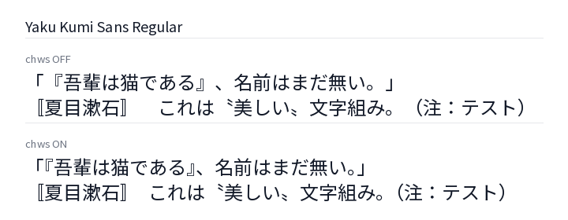

# yaku-kumi-fonts

[](https://www.jsdelivr.com/package/gh/daiji256/yaku-kumi-fonts)

Noto CJK フォントシリーズ（Noto Sans JP, Noto Serif JP）の約物（句読点・括弧類など 28 文字）をサブセット化し、OpenType `chws`（約物詰め）機能を保持・最適化した Web フォントです。



## 特徴

- **約物詰め（chws / vchw）対応**: 隣接する約物の余白を自動で詰める OpenType 機能を最適化。
- **軽量サブセット**: 句読点・括弧類・約物 28 文字のみを収録（TTF, WOFF, WOFF2）。
- **フォント合成での利用**: CSS でベースフォントの手前に指定することで、約物のみカーニングを有効化。

## 収録約物（28文字）

```
、。，．・：；（）「」『』［］｛｝【】〈〉《》〔〕〝〟　
```

## 利用方法

### CSS の読み込み (jsDelivr)

利用したいフォントファミリーに応じて、jsDelivr 経由で CSS を読み込みます。

```html
<link
  rel="stylesheet"
  href="https://cdn.jsdelivr.net/gh/daiji256/yaku-kumi-fonts@3.0.0/css/yaku-kumi-sans.min.css"
/>
```

| フォントファミリー | 収録ウェイト | jsDelivr URL |
|---|---|---|
| すべて（全17書体） | 全ウェイト | `https://cdn.jsdelivr.net/gh/daiji256/yaku-kumi-fonts@3.0.0/css/yaku-kumi.min.css` |
| Yaku Kumi Sans | 100, 200, 300, 400, 500, 600, 700, 800, 900 | `https://cdn.jsdelivr.net/gh/daiji256/yaku-kumi-fonts@3.0.0/css/yaku-kumi-sans.min.css` |
| Yaku Kumi Serif | 200, 300, 400, 500, 600, 700, 800, 900 | `https://cdn.jsdelivr.net/gh/daiji256/yaku-kumi-fonts@3.0.0/css/yaku-kumi-serif.min.css` |

### CSS の設定

`font-family` の先頭に Yaku Kumi フォントを指定し、OpenType 機能 `chws` を有効にします。

```css
/* ゴシック体（Sans）の例 */
body {
  font-family: "Yaku Kumi Sans", "Noto Sans JP", sans-serif;
  font-feature-settings: "chws" 1;
}

/* 明朝体（Serif）の例 */
body {
  font-family: "Yaku Kumi Serif", "Noto Serif JP", serif;
  font-feature-settings: "chws" 1;
}
```

## ビルドとテスト

[uv](https://github.com/astral-sh/uv) を使用してビルド、テスト、リント、フォーマットを実行します。

### ビルド

元フォントのダウンロード、インスタンス化、メトリクス正規化、chws 検証、サブセット化、TTF/WOFF/WOFF2 および CSS の書き出しを行います。

```bash
uv run build.py
```

### テスト

フォント整合性、CSS 配信ファイル、およびビジュアルリグレッションテストを実行します。

```bash
uv run test.py
```

ビジュアル specimen 画像を更新する場合は `--update` を指定します。

```bash
uv run test.py --update
```

### リント

Ruff による静的解析（コード検証）を実行します。

```bash
uvx ruff check
```

### フォーマット

Ruff によるコードフォーマットを適用します。

```bash
uvx ruff format
```

## ライセンス

- **フォント**: [SIL Open Font License 1.1](OFL.txt)
- **ビルド・テストスクリプト**: [MIT License](LICENSE)
